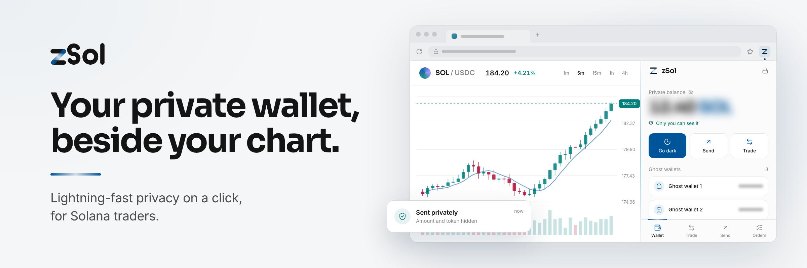
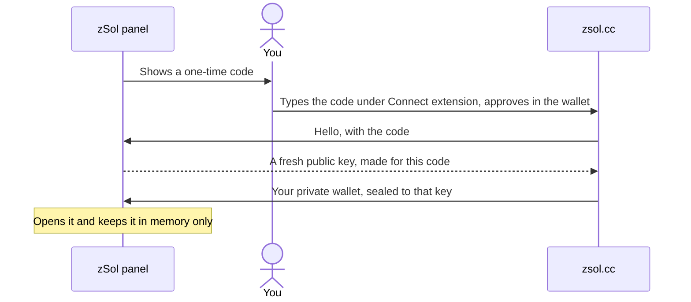

<p align="center">
  <picture>
    <source media="(prefers-color-scheme: dark)" srcset=".github/assets/header-dark.png">
    
  </picture>
</p>

# zSol for Chrome

zSol is a privacy terminal on Solana: zk-SNARKs keep the amounts and tokens in your balance hidden.
zSol for Chrome puts its private wallet in your browser's side panel, beside the chart you trade
from. Go dark, send, pay many and trade from ghost wallets without leaving the page. Built on
Helius Privacy Rings.

**Open source, so anyone can check what it does with your keys.**

[Website](https://zsol.cc) · [How connecting works](#how-connecting-works) ·
[Permissions](#permissions) · [Audit it yourself](#audit-it-yourself)

> [!IMPORTANT]
> zSol for Chrome is in early development. It is not in the Chrome Web Store yet, and it connects
> to your zSol account but cannot trade or send yet. Until it can, use zSol at
> [zsol.cc](https://zsol.cc).

## What it does

### Opens beside your chart

Press the zSol button in Chrome's toolbar and zSol opens in the side panel, next to the page you
are on. It stays open as you switch tabs.

### Connects with a one-time code

No seed phrase to type and no wallet window in the panel. The panel shows an 8-character code;
type it on zsol.cc under Connect extension and approve once in your wallet.

## Roadmap

- [x] zSol in Chrome's side panel, opened from the toolbar
- [x] Connect to your zSol account with a one-time code
- [ ] **Wallet:** your private balance and your ghost wallets
- [ ] **Trade:** swap from a ghost wallet or your private balance, in one click
- [ ] **Send:** Send dark and Pay many, from your private balance
- [ ] **Go dark:** move SOL into your private balance by Ghost Route
- [ ] **Over your terminal:** zSol on top of Axiom, GMGN, Terminal and more, only on the sites
      where you turn it on

## How connecting works

The panel never asks for a seed phrase. zsol.cc hands your private wallet over, sealed to a key
the panel made a moment before.



- **Only zsol.cc can reach the panel.** Chrome passes it messages from `https://zsol.cc` alone,
  and the panel checks the sender again. It listens only while the code is on screen.
- **The code is short-lived.** 8 characters, good for 2 minutes and one use. After 5 wrong tries
  it is replaced.
- **The wallet travels sealed.** zsol.cc seals it with HPKE (RFC 9180: X25519, HKDF-SHA256,
  AES-256-GCM), bound to the code, the site and this extension's id, so it opens nowhere else.
- **It stays in memory.** The panel keeps your wallet's seed in memory only. Disconnect, or
  closing the panel, forgets it.

## Safe by design

- **Your keys stay on your device.** The panel signs on your machine; nothing it holds is sent to
  us in the clear.
- **The fewest permissions possible.** No access to the pages you visit, no content scripts, no
  host permissions. The overlay will ask for a site only when you turn it on there.
- **No code from the network.** Everything the extension runs ships inside the package.
  `pnpm check:build` fails any build that loads a script from the network or asks for a
  permission not on its list.
- **No tracking.** The extension sends no analytics and no error reports.
- **A careful supply chain.** Every dependency is pinned to an exact version at least 7 days old,
  install scripts run only when listed, and CI pins each action to a commit.

### Permissions

| What the extension asks Chrome for                  | Why                                                        |
| --------------------------------------------------- | ---------------------------------------------------------- |
| `sidePanel`                                         | Opens zSol in the side panel from the toolbar button       |
| `externally_connectable` for `https://zsol.cc` only | Lets zsol.cc hand your sealed wallet over when you connect |

That is all. Every permission the extension adds is explained in its pull request.

## Audit it yourself

Every line the extension runs is in this repository. Good places to start:

| What                                        | Where                                                                            |
| ------------------------------------------- | -------------------------------------------------------------------------------- |
| Permissions and who may message the panel   | [`src/manifest.ts`](src/manifest.ts)                                             |
| The one-time code                           | [`src/features/pairing/code.ts`](src/features/pairing/code.ts)                   |
| The checks on every message from zsol.cc    | [`src/features/pairing/handler.ts`](src/features/pairing/handler.ts)             |
| The sealed handover                         | [`src/features/pairing/protocol.ts`](src/features/pairing/protocol.ts)           |
| Where the wallet is kept                    | [`src/features/session/session-store.ts`](src/features/session/session-store.ts) |
| What every build is checked for             | [`scripts/check-build.mjs`](scripts/check-build.mjs)                             |
| End-to-end tests against a stand-in zsol.cc | [`tests/e2e`](tests/e2e)                                                         |

## Develop

You need Node 22.12 or newer (CI uses the version in `.node-version`), pnpm (the version in
`package.json`, which Corepack or pnpm itself picks up) and Chrome.

```sh
pnpm install
pnpm dev
```

`pnpm dev` builds into `.output/chrome-mv3-dev` and rebuilds on every change. In Chrome, open
`chrome://extensions`, turn on **Developer mode**, press **Load unpacked** and choose that folder,
then press the zSol button in the toolbar. Development builds keep a fixed extension id,
`imigicgmjamahdpfeiciegalcbgpmfhh`, and also accept a local zsol.cc.

| Command            | What it does                                                            |
| ------------------ | ----------------------------------------------------------------------- |
| `pnpm check`       | Types, lint, unit tests and formatting                                  |
| `pnpm build`       | Production build in `.output/chrome-mv3`                                |
| `pnpm check:build` | Checks the build: permissions, policy, no remote code, no machine paths |
| `pnpm test:e2e`    | Loads the build into headless Chromium and tests the panel              |

The first `pnpm test:e2e` needs Playwright's Chromium: `pnpm exec playwright install chromium`.

Built with [WXT](https://wxt.dev), React 19 and the React Compiler, Tailwind CSS 4, shadcn/ui on
Base UI, TypeScript, Vitest and Playwright.

## Contributing

Read [CONTRIBUTING.md](CONTRIBUTING.md) and [AGENTS.md](AGENTS.md): every change, by a person or a
coding agent, follows them.

## Security

zSol is a wallet: a security bug can cost people money. Report it privately through
[GitHub security advisories](https://github.com/shieldonzsol/zsol-extension/security/advisories/new), never in a public issue. We answer
within 3 working days; [SECURITY.md](SECURITY.md) has the details.

The only official builds are the ones linked from [zsol.cc](https://zsol.cc). An extension that
uses the zSol name anywhere else is not ours.

## License

The code is under the [MIT License](LICENSE). The zSol name and logo are trademarks of zSol and
are not covered by the license: a fork must use its own name and logo.
